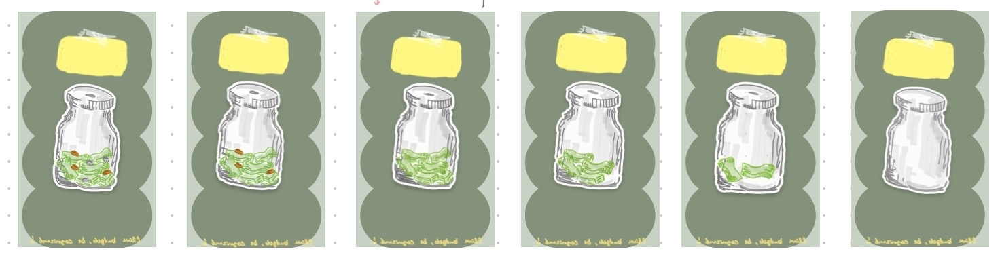

# Clink 🪙

**Hear the clink. Stop and think.**

Clink makes Apple Pay spending feel real again. Set a daily or weekly cap, and every time you tap to pay you hear a *clink* and get a notification showing what you spent and what's left.

<p align="center">
  
</p>

## The problem
Tap-to-pay makes paying so effortless that spending stops registering. Many people rarely open their bank app afterwards, and when they finally do, the balance is a surprise. Some start avoiding their bank app altogether because they're anxious about what they'll see.

**Clink closes that gap with real-time feedback on every Apple Pay purchase.**

## How it works
1. **Set a cap** for the day or week.
2. **Pay with Apple Pay** as usual. An Apple Shortcuts automation sends the purchase to Clink within seconds.
3. **Hear the clink** and see "You spent $6 at Starbucks · $34 left."
4. **Watch the jar** on the home screen empty as you spend.
5. **Get a heads-up** near your limit, and a nudge to check your bank app when you reach it.

No bank login required. Clink only sees the amount and merchant of each Apple Pay purchase.

## Status: 🚧 In development
| Phase | Status |
|---|---|
| Problem definition & user journey | ✅ Done |
| User stories & MVP scope | ✅ Done |
| Paper wireframes | ✅ Done |
| ER diagram, schema, API design | 🔄 In progress |
| Figma designs | ⏳ Next |
| Backend (Node.js, Express, Sequelize, SQL) | ⏳ Next |
| Frontend (React) | ⏳ Planned |
| Shortcut integration & deployment | ⏳ Planned |

## Tech stack (planned)
- **Frontend:** React
- **Backend:** Node.js, Express
- **Database:** SQL with Sequelize ORM
- **Integration:** Apple Shortcuts "Transaction" automation → Clink API
- **Design:** Paper sketches → Figma

## Design process
Every step is documented in [`docs/`](docs/):
- [User journey](docs/user-journey.md): the experience before and after Clink
- [User stories](docs/user-stories.md): MVP scope, acceptance criteria, known limitations
- [Decision log](docs/decision-log.md): key product decisions and the reasoning behind them
- [Wireframes](docs/wireframes/): paper sketches and jar artwork

## Project structure
```
Clink/
├── client/   # React frontend
├── server/   # Node.js + Express API
└── docs/     # Research, user stories, wireframes, decisions
```

## Author
**Marie-Blanche Boti Lou**, Learning Technology & Performance Systems, Texas A&M University
