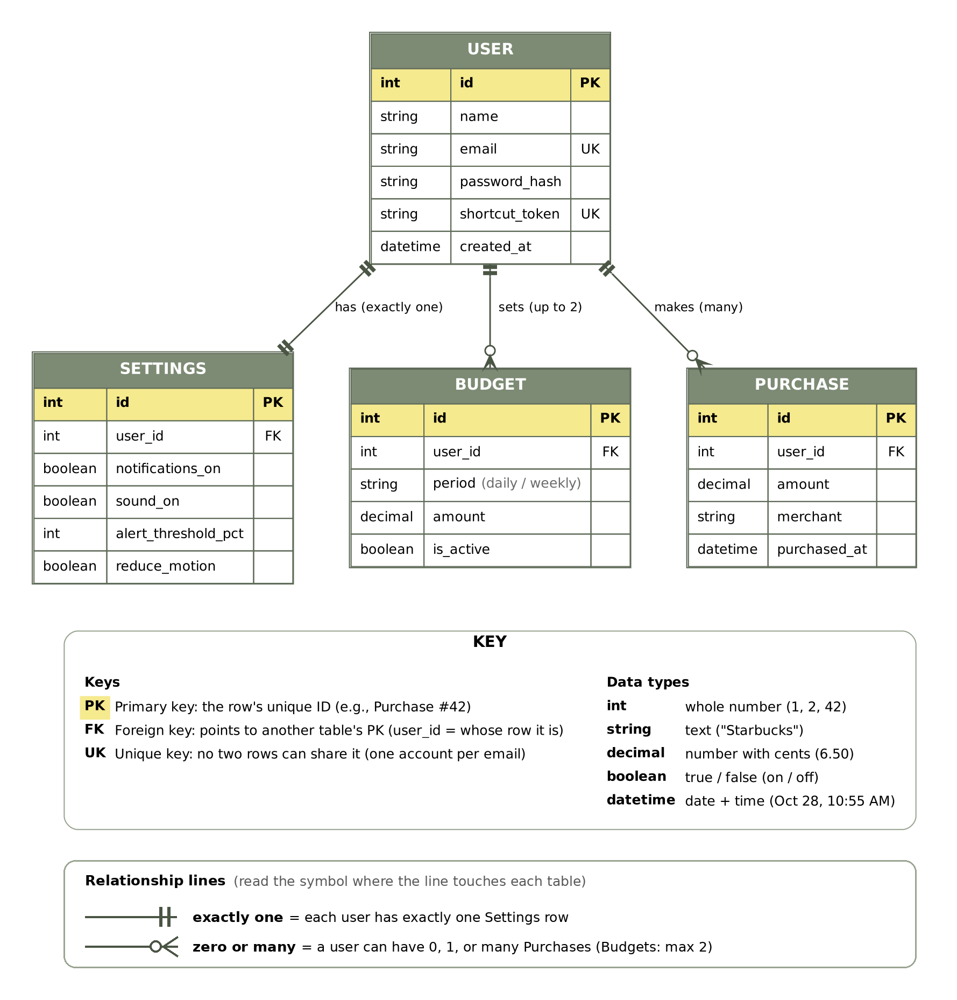

# Clink: ER Diagram

An entity-relationship (ER) diagram shows **what Clink stores** and **how those things connect**. It's the blueprint for the database: each box becomes a table, and each line becomes a link between tables.

Primary keys are **bolded and highlighted in yellow**. The key at the bottom of the image explains each label, data type, and line symbol. *(Diagram source: [`diagrams/er-diagram.dot`](diagrams/er-diagram.dot), rendered with Graphviz.)*

---

## Entities

| Entity | What it is | Key attributes |
|---|---|---|
| **User** | A person using Clink | name, email, password (hashed), shortcut token |
| **Settings** | That user's preferences | notifications on/off, clink sound on/off, alert level (%), reduce motion |
| **Budget** | A spending cap | period (daily or weekly), amount, on/off |
| **Purchase** | One Apple Pay transaction | amount, merchant, date & time |

## Relationships

| Relationship | Type | Meaning |
|---|---|---|
| User → Settings | **One-to-one** | Every user has exactly one set of settings. |
| User → Budget | **One-to-many (max 2)** | A user can have a daily budget, a weekly budget, both, or neither, but only one of each period. |
| User → Purchase | **One-to-many** | A user makes many purchases; each purchase belongs to one user. |

## Key terms
- **PK (primary key):** the unique ID for each row, e.g. Purchase #42.
- **FK (foreign key):** a column that points to another table's PK. `user_id` in Purchase says *whose* purchase it is.
- **UK (unique key):** no two rows can share this value. Two users can't sign up with the same email.

## Design notes
- **Settings has its own table** rather than living inside User. User stays focused on identity and login, and new settings can be added later without changing the User table.
- **No separate Alerts table.** Alerts ("Heads up," "You've reached your limit") are calculated from Purchases and Budget when they happen. Purchase history is the record users look back on.
- **No "remaining" column.** What's left is calculated (budget amount − total of purchases in the period) rather than stored, so it can never get out of sync.
- **Shortcut token** is unique per user. The Apple Pay shortcut sends it with each purchase so the server knows whose purchase it is.

## Open question
- If both a daily and a weekly budget are on, which one does the jar show? (Option: whichever the user is closer to running out of.)
