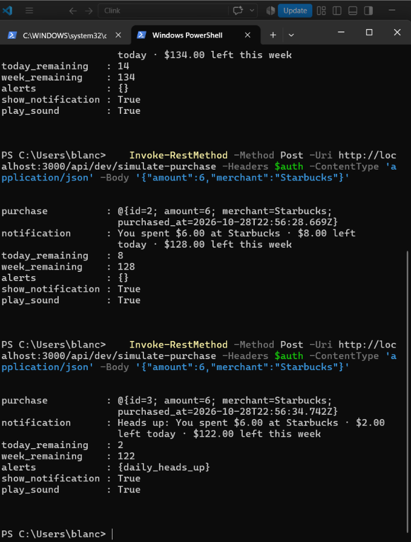

# Clink API (server)

Node.js + Express + Sequelize + PostgreSQL. Endpoints are designed in [`../docs/api.md`](../docs/api.md); tables match [`../docs/schema.md`](../docs/schema.md).

## Run it locally
**Prerequisites:** Node.js 20+ and PostgreSQL, with two empty databases: `clink_dev` and `clink_test`.

```bash
cd server
npm install                # install dependencies
cp .env.example .env       # then put your PostgreSQL password in .env
npm run db:migrate         # create the tables in clink_dev
npm run dev                # start the API at http://localhost:3000
```
Check it's running: open http://localhost:3000/api/health and you should see `{"status":"ok","database":"connected"}`.

## Run the tests
```bash
npm test                   # uses clink_test, never your real data
```

## Project structure
```
server/
├── src/
│   ├── config/database.js   # connection settings per environment
│   ├── models/              # User, Settings, Budget, Purchase (+ relationships)
│   ├── migrations/          # creates the tables
│   ├── routes/              # one file per group of endpoints
│   ├── middleware/          # login check, error handling
│   ├── utils/               # tokens, error class
│   ├── app.js               # wires everything together
│   └── server.js            # starts the server
└── tests/                   # Jest + Supertest
```

## Progress
| Endpoint | Status |
|---|---|
| `GET /api/health` | ✅ |
| `POST /api/auth/signup` · `POST /api/auth/login` · `GET /api/me` | ✅ |
| `GET /api/budgets` · `PUT /api/budgets` (weekly + daily caps) | ✅ |
| `GET /api/status` (Home screen / jar) | ✅ |
| `POST /api/purchases` (**the clink**) | ✅ |
| `GET /api/shortcut` · `POST /api/shortcut/regenerate` · `POST /api/shortcut/test` | ✅ |
| `POST /api/dev/simulate-purchase` (development only) | ✅ |
| History, settings, account updates/deletion | ⏳ Next |

**45 automated tests** cover sign-up and login, budget rules (daily caps must fit inside the weekly budget), notification wording, alerts, time zones (a late-night purchase counts toward the user's own day), and shortcut security.

## Try the clink yourself
With the server running (`npm run dev`), in a second PowerShell window:
```powershell
# 1. Sign up and keep the login token
$r = Invoke-RestMethod -Method Post -Uri http://localhost:3000/api/auth/signup -ContentType 'application/json' -Body '{"name":"Marie","email":"me@example.com","password":"supersecret1"}'
$auth = @{ Authorization = "Bearer $($r.token)" }

# 2. Set a $140 week with $20 a day
Invoke-RestMethod -Method Put -Uri http://localhost:3000/api/budgets -Headers $auth -ContentType 'application/json' -Body '{"weekly":{"amount":140},"daily":{"mode":"same","amount":20}}'

# 3. Simulate an Apple Pay purchase and see the notification
Invoke-RestMethod -Method Post -Uri http://localhost:3000/api/dev/simulate-purchase -Headers $auth -ContentType 'application/json' -Body '{"amount":6,"merchant":"Starbucks"}'
```

Run step 3 a few times and watch what's left go down, then the **heads-up** appear:


